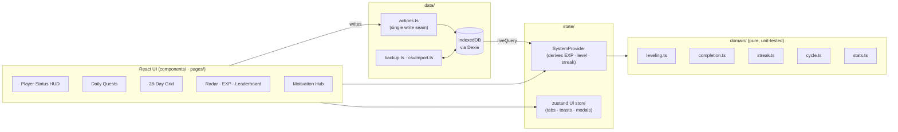

<div align="center">


# The System · RPG Habit Tracker

**Turn your daily habits into quests. Earn EXP, keep your streak, rank up from E to S.**

An offline-first Progressive Web App inspired by the *“System”* HUD from the Solo Leveling webtoon.
I rebuilt it from my own Google Sheets habit tracker so it could do what a spreadsheet can't.


[**Live demo →**](#-deployment) · [Features](#-features) · [Screenshots](#-screenshots) · [Architecture](#-architecture) · [Design decisions](#-design-decisions-backed-by-research)

</div>

---

## Why I built this

I tracked 27 daily habits in a Google Sheet: a 28-day checkbox grid, weekly donut charts, and an EXP column.
It worked, but a spreadsheet **can't embed a video, play a sound, animate a level-up, or feel good to use on a phone.**
Those small rewards are what keep a habit going.

So I rebuilt it as a real app, with one rule: **checking in must take under 2 seconds, and nothing should ever make me feel bad for being human.**

## 🎨 The look: "System windows"

Every screen is a **System window**, modelled on the blue holographic HUD from the anime:
translucent deep-blue glass, a bright glowing 1px frame, a circled **"!"** glyph with a boxed title (`STATUS`, `QUEST INFO`, `NOTIFICATION`), and a light-flash *pop-in* when a window opens. Faint mana motes drift up through the background.

- **STATUS** shows a big LEVEL number, `JOB / TITLE / NAME`, EXP and QUEST bars, and a stat table (`STR · AGI · INT · VIT · SEN`).
- **QUEST INFO** opens with *[Daily Quest has arrived.]*, then a GOAL list with `[0/1]` counters, a REWARD line, and a red **WARNING** about the Emergency Quest.
- **NOTIFICATION** windows announce every cleared quest, a completed daily quest, and each *LEVEL UP!*

All artwork, text, and audio are original. The style is inspired by the anime, not copied from it.

## ✨ Features

| | |
|---|---|
| ⚔️ **Daily Quest window** | One tap per quest, grouped by category, with difficulty and attribute tags and live EXP |
| 🏅 **Hunter Rank & Levels** | Total EXP drives Level 1 → 26+ and rank E → D → C → B → A → S (S-Rank Lv 36+ unlocks *National Level*) |
| 🔥 **Forgiving streaks** | Counts days with ≥ 50% completion. Today never breaks it while it's still in progress, and **rest days** neither break nor extend it |
| 📅 **28-day habit grid** | The spreadsheet view, upgraded: sticky columns, a glowing *today* beam, per-quest totals, and a daily % row |
| 🍩 **Weekly analytics** | 4 donut rings + daily bar charts, colour-coded W1 cyan → W4 crimson |
| 🕸️ **Attribute radar** | STR · AGI · INT · VIT · SEN, built from the EXP earned in each attribute |
| 📈 **EXP history & leaderboard** | Cumulative EXP curve (30D/90D/1Y) and the top 10 most consistent quests |
| 🎬 **Motivation Hub** | Quote + embedded **YouTube / Shorts**, **Facebook Reels**, or **your own MP4/WebM** (stored offline), with theater mode |
| 🎵 **System Anthem & SFX** | Sound effects and a looping anthem, **synthesized live with the Web Audio API** (0 KB of audio files) |
| 🚨 **Emergency Quest** | After 10 PM with < 40% done, a pulsing red *Penalty Zone* alert appears (it's a warning only and never takes anything away) |
| 🆙 **Level-up / Rank-up modal** | A full-screen System notification with a particle burst |
| 🗂️ **Quest editor** | Add, edit, reorder, **schedule by weekday**, archive (keeps EXP) or delete |
| 💾 **Backups & migration** | One-click JSON export/restore, a **Google Sheets CSV importer**, and a weekly backup reminder |
| 📱 **Installable PWA** | Works offline, installs to your home screen, and has a mobile bottom navigation bar |

## 📸 Screenshots

| Today (desktop) | 28-Day Grid |
|---|---|
|  |  |
| **Stats** | **Level up** |
|  |  |

<p align="center">
  
  &nbsp;&nbsp;
  
</p>

> Screenshots are generated automatically from the production build in demo mode (`npm run screenshots`).

## 🧠 Design decisions (backed by research)

Before writing code I studied what successful habit apps do (Habitica, Streaks, Finch, and the wave of Solo-Leveling-style apps) and **why people quit them**. Five findings shaped the design:

| Finding | What I built |
|---|---|
| **Streak anxiety** is one of the most common reasons people abandon habit trackers | A forgiving streak: rest days, and *today* doesn't count against you until it's over |
| Habitica's biggest complaint is "everything is daily," which punishes habits like *training-day-only* | **Weekday schedules**. Unscheduled days don't count against your completion % |
| **Data loss** is the #1 theme in 1–3★ reviews | Local-first IndexedDB, persistent-storage request, JSON backups, and a 7-day backup reminder |
| Too many effects make gamification tiring | Small effects (a chirp and a toast) for each check-in; fanfare only for a level-up or a 100% day |
| Friction kills habits | One-tap check-in, a phone-first layout, and a PWA that opens instantly and works offline |

Full research notes and the original build plan: [docs/PLAN.md](docs/PLAN.md).

## 🏗 Architecture



**Key principles**

- **Store facts, derive everything else.** Only quests, completions, rest days, and settings are persisted. EXP, level, rank, streak, and percentages are computed by pure functions, so they can never drift out of sync.
- **History is saved with each record.** Each completion stores the EXP it was worth at the time, so editing a quest's reward never rewrites the past.
- **Local dates, never UTC.** A late-night check-in in Dhaka (UTC+6) lands on the correct day.
- **One write seam** (`data/actions.ts`) keeps the app ready for an optional cloud-sync adapter (Supabase schema included in [docs/DATA-MODEL.md](docs/DATA-MODEL.md)).

More detail: [docs/ARCHITECTURE.md](docs/ARCHITECTURE.md).

## 🧰 Tech stack

| Layer | Choice | Why |
|---|---|---|
| UI | **React 18 + TypeScript (strict)** | Component model and type safety |
| Build | **Vite 5** | Instant dev server, small production builds |
| Styling | **Tailwind CSS** | Design tokens for the neon/glass "System" look |
| Motion | **Framer Motion** | Spring animations, modal and particle effects |
| Charts | **Recharts** + hand-built SVG donuts | Radar, area, and bar charts with tooltips |
| Storage | **Dexie (IndexedDB)** + `dexie-react-hooks` | Offline-first, reactive live queries |
| State | **zustand** | Tiny store for UI-only state |
| PWA | **vite-plugin-pwa (Workbox)** | Installable, offline, auto-updating |
| Audio | **Web Audio API** | Synthesized sound effects and anthem, no assets |
| Tests | **Vitest** | 24 unit tests over the domain, import, and media logic |
| Tooling | **playwright-core** | Automated README screenshots using the local Edge browser |

## 🚀 Getting started

```bash
# requires Node.js 18+
npm install
npm run dev          # http://localhost:5173
npm test             # unit tests
npm run build        # production build → dist/
npm run preview      # serve the build locally
```

Open `http://localhost:5173/?demo=1` in a fresh browser profile to load **demo data** (it only fills an empty database).

| Script | What it does |
|---|---|
| `npm run screenshots` | Builds screenshots of every page (desktop and mobile) into `docs/screenshots/` |
| `python scripts/make_cover.py` | Composes the README banner and LinkedIn cover image |
| `python scripts/make_icons.py` | Regenerates the PWA icons |

## 📦 Deployment

It's a static site with **no backend and no running costs**. The recommended setup is **GitHub Pages** (a workflow is included) or **Vercel / Netlify / Cloudflare Pages** (zero config). Step-by-step instructions, plus how to install it on your phone: **[docs/DEPLOYMENT.md](docs/DEPLOYMENT.md)**.

## 🗺 Roadmap

- [ ] Optional Supabase sync (magic-link login, multi-device)
- [ ] Push-notification reminders (morning quest / 9 PM emergency)
- [ ] Weekly "Dungeon" boss challenges and titles
- [ ] Shareable progress card (PNG) for social posts

## 📄 License & credits

MIT © Asif Hossain. *Solo Leveling* is the property of its creators. This is an independent fan-inspired project. All artwork, icons, and audio here are original (the audio is synthesized in code) and no official assets are used.
