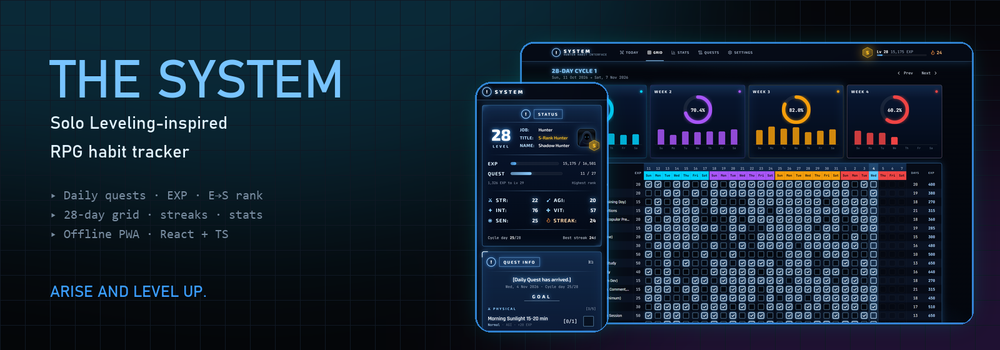
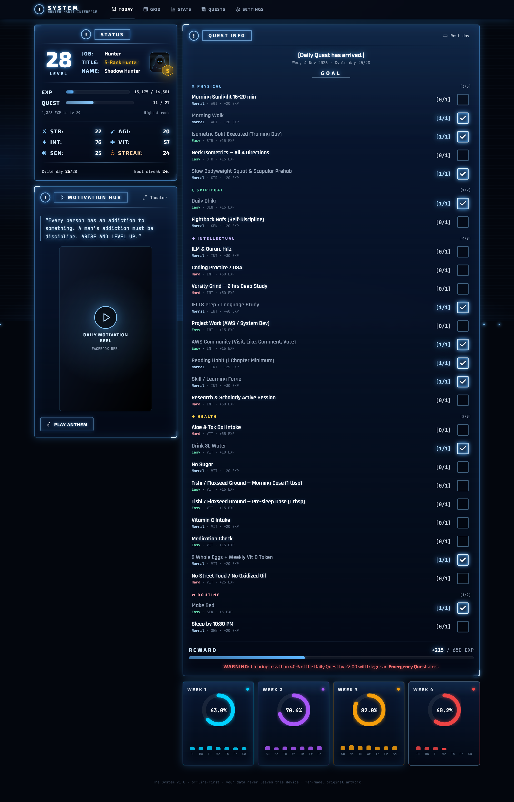
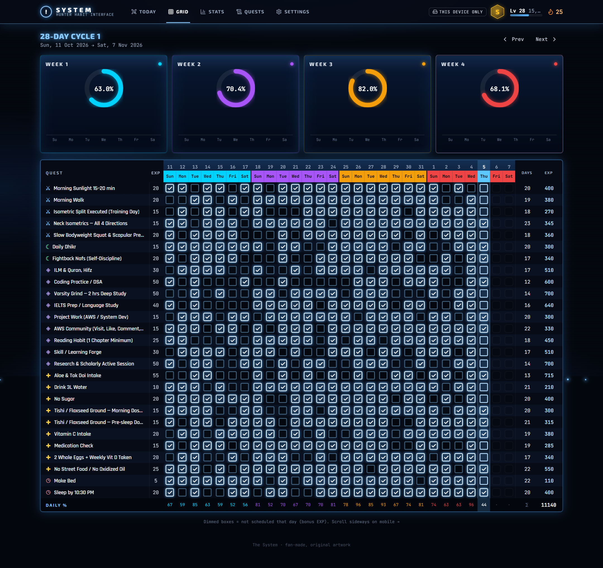
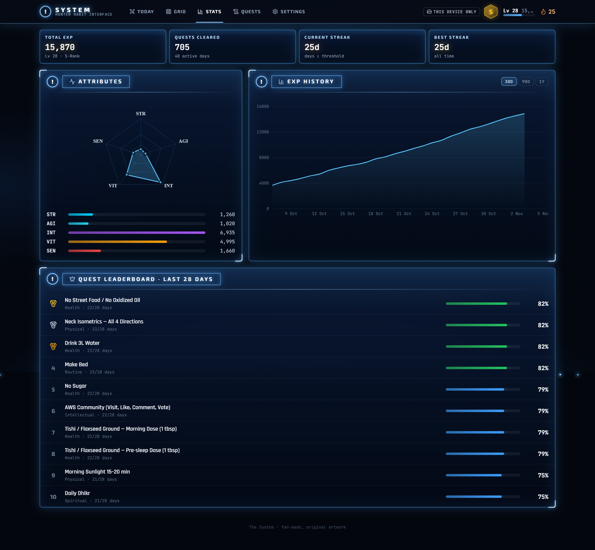
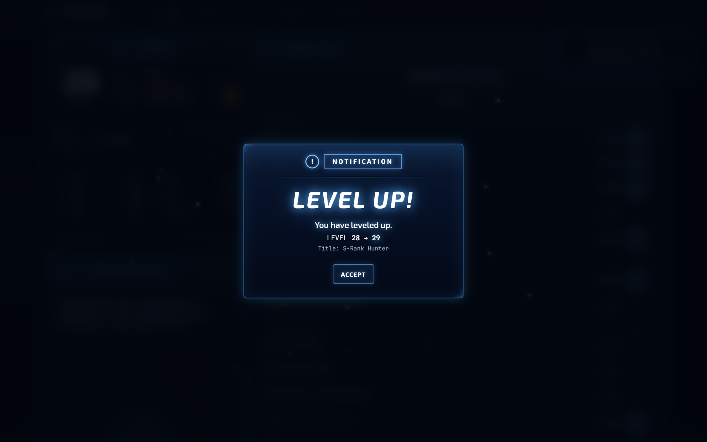
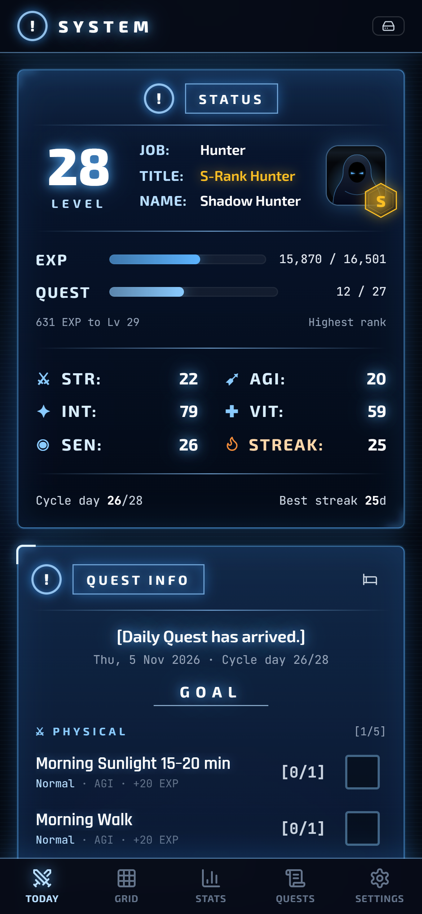
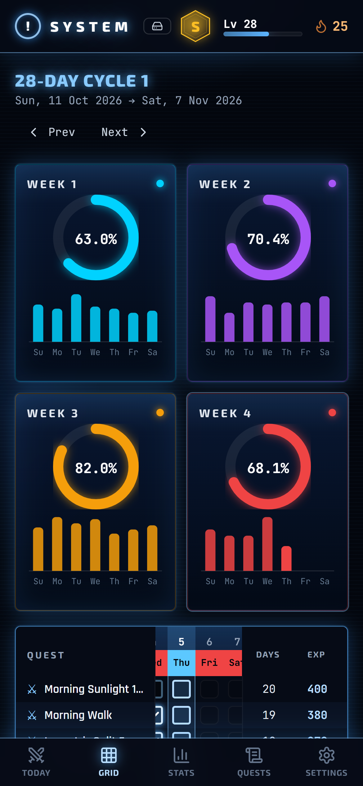
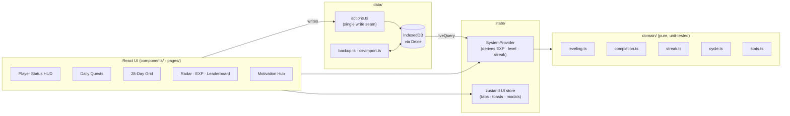

<div align="center">



# The System · RPG Habit Tracker

**Turn your daily habits into quests. Earn EXP, keep your streak, rank up from E to S.**

A Progressive Web App with free accounts and multi-device sync, inspired by the *“System”* HUD from the Solo Leveling webtoon.
I rebuilt it from my own Google Sheets habit tracker so it could do what a spreadsheet can't.


[**Set it up →**](#-put-it-online-with-accounts-free) · [Features](#-features) · [Screenshots](#-screenshots) · [Architecture](#-architecture) · [Design decisions](#-design-decisions-backed-by-research)

</div>

---

## Why I built this

I tracked 27 daily habits in a Google Sheet: a 28-day checkbox grid, weekly donut charts, and an EXP column.
It worked, but a spreadsheet **can't embed a video, play a sound, animate a level-up, or feel good to use on a phone.**
Those small rewards are what keep a habit going.

So I rebuilt it as a real app, with one rule: **checking in must take under 2 seconds, and nothing should ever make me feel bad for being human.**

## 🎨 The look: "System windows"

Every screen is a **System window**, modelled on the blue holographic HUD from the anime:
translucent deep-blue glass, a bright glowing 1px frame, a circled **"!"** glyph with a boxed title (`STATUS`, `QUEST INFO`, `NOTIFICATION`), and a light-flash *pop-in* when a window opens. Faint mana motes drift up through the background.

- **STATUS** shows a big LEVEL number, `JOB / TITLE / NAME`, EXP and QUEST bars, and a stat table (`STR · AGI · INT · VIT · SEN`).
- **QUEST INFO** opens with *[Daily Quest has arrived.]*, then a GOAL list with `[0/1]` counters, a REWARD line, and a red **WARNING** about the Emergency Quest.
- **NOTIFICATION** windows announce every cleared quest, a completed daily quest, and each *LEVEL UP!*

All artwork, text, and audio are original. The style is inspired by the anime, not copied from it.

## ✨ Features

| | |
|---|---|
| ⚔️ **Daily Quest window** | One tap per quest, grouped by category, with difficulty and attribute tags and live EXP |
| 🏅 **Hunter Rank & Levels** | Total EXP drives Level 1 → 26+ and rank E → D → C → B → A → S (S-Rank Lv 36+ unlocks *National Level*) |
| 🔥 **Forgiving streaks** | Counts days with ≥ 50% completion. Today never breaks it while it's still in progress, and **rest days** neither break nor extend it |
| 📅 **28-day habit grid** | The spreadsheet view, upgraded: sticky columns, a glowing *today* beam, per-quest totals, and a daily % row |
| 🍩 **Weekly analytics** | 4 donut rings + daily bar charts, colour-coded W1 cyan → W4 crimson |
| 🕸️ **Attribute radar** | STR · AGI · INT · VIT · SEN, built from the EXP earned in each attribute |
| 📈 **EXP history & leaderboard** | Cumulative EXP curve (30D/90D/1Y) and the top 10 most consistent quests |
| 🎬 **Motivation Hub** | Quote + embedded **YouTube / Shorts**, **Facebook Reels**, or **your own MP4/WebM** (stored offline), with theater mode |
| 🎵 **System Anthem & SFX** | Sound effects and a looping anthem, **synthesized live with the Web Audio API** (0 KB of audio files) |
| 🚨 **Emergency Quest** | After 10 PM with < 40% done, a pulsing red *Penalty Zone* alert appears (it's a warning only and never takes anything away) |
| 🆙 **Level-up / Rank-up modal** | A full-screen System notification with a particle burst |
| 🗂️ **Quest editor** | Add, edit, reorder, **schedule by weekday**, archive (keeps EXP) or delete |
| 💾 **Backups & migration** | One-click JSON export/restore, a **Google Sheets CSV importer**, and a weekly backup reminder |
| 📱 **Installable PWA** | Works offline, installs to your home screen, and has a mobile bottom navigation bar |

## 📸 Screenshots

| Today (desktop) | 28-Day Grid |
|---|---|
|  |  |
| **Stats** | **Level up** |
|  |  |

<p align="center">
  
  &nbsp;&nbsp;
  
</p>

> Screenshots are generated automatically from the production build in demo mode (`npm run screenshots`).

## 🧠 Design decisions (backed by research)

Before writing code I studied what successful habit apps do (Habitica, Streaks, Finch, and the wave of Solo-Leveling-style apps) and **why people quit them**. Five findings shaped the design:

| Finding | What I built |
|---|---|
| **Streak anxiety** is one of the most common reasons people abandon habit trackers | A forgiving streak: rest days, and *today* doesn't count against you until it's over |
| Habitica's biggest complaint is "everything is daily," which punishes habits like *training-day-only* | **Weekday schedules**. Unscheduled days don't count against your completion % |
| **Data loss** is the #1 theme in 1–3★ reviews | Cloud accounts, changes held safely on the device until the server confirms them, JSON backups, and a 7-day backup reminder |
| Too many effects make gamification tiring | Small effects (a chirp and a toast) for each check-in; fanfare only for a level-up or a 100% day |
| Friction kills habits | One-tap check-in, a phone-first layout, and a PWA that opens instantly and works offline |

Full research notes and the original build plan: [docs/PLAN.md](docs/PLAN.md).

## 🏗 Architecture



**Key principles**

- **Store facts, derive everything else.** Only quests, completions, rest days, and settings are persisted. EXP, level, rank, streak, and percentages are computed by pure functions, so they can never drift out of sync.
- **History is saved with each record.** Each completion stores the EXP it was worth at the time, so editing a quest's reward never rewrites the past.
- **An explicit timezone, never UTC.** A late-night check-in in Dhaka (UTC+6) lands on the correct day, on every device.
- **One write path** (`data/actions.ts`) queues every change for upload in the same transaction that saves it. See [docs/DATA-MODEL.md](docs/DATA-MODEL.md).

More detail: [docs/ARCHITECTURE.md](docs/ARCHITECTURE.md).

## 🧰 Tech stack

| Layer | Choice | Why |
|---|---|---|
| UI | **React 18 + TypeScript (strict)** | Component model and type safety |
| Build | **Vite 5** | Instant dev server, small production builds |
| Styling | **Tailwind CSS** | Design tokens for the neon/glass "System" look |
| Motion | **Framer Motion** | Spring animations, modal and particle effects |
| Charts | **Recharts** + hand-built SVG donuts | Radar, area, and bar charts with tooltips |
| Storage | **Dexie (IndexedDB)** + `dexie-react-hooks` | Instant local reads, and a safe queue for unsent changes |
| Accounts & sync | **Supabase** (Auth + Postgres + Row Level Security) | Free sign-in and private cloud storage |
| State | **zustand** | Tiny store for UI-only state |
| PWA | **vite-plugin-pwa (Workbox)** | Installable, offline, auto-updating |
| Audio | **Web Audio API** | Synthesized sound effects and anthem, no assets |
| Tests | **Vitest**, **PGlite** | Unit tests, plus sync and security tests on real Postgres |
| Tooling | **playwright-core** | Automated README screenshots using the local Edge browser |

## 🚀 Put it online with accounts (free)

**Supabase** stores accounts and progress. **Cloudflare** hosts the website and gives you a free address. Both are free, and neither needs a credit card.

> **Why not host the website on Supabase too?** On the free plan, Supabase can't serve websites: pages come out as plain text. Making it work needs Supabase Pro plus a paid custom domain, about $35/month. The research and a comparison of other hosts is in [docs/HOSTING.md](docs/HOSTING.md).

You'll need about 30 minutes. Do the parts in order.

| Part | Where | What you get |
|---|---|---|
| **A** (Steps 1–3) | Supabase | Database, sign-in, and your two keys |
| **B** (Steps 4–6) | GitHub, then Cloudflare | Your live address: `https://solo-leveling-habit-tracker.<your-name>.workers.dev` |
| **C** (Steps 7–9) | Supabase, then your browser | Email links working, your old progress imported, and everything checked |

---

### Part A: Supabase (accounts and data)

#### Step 1: Create the Supabase project

1. Go to <https://supabase.com> and sign up. GitHub sign-in is fine.
2. Click **New project**.
3. Fill in:
   - **Name:** for example `the-system`.
   - **Database password:** click Generate, then save it in a password manager. **This password never goes in any project file.**
   - **Region:** pick one near you. Singapore or Mumbai are close to Bangladesh.
4. Click **Create new project**, and wait 1–2 minutes until it is ready.

#### Step 2: Create the database tables

1. In the left menu, open **SQL Editor** and click **New query**.
2. Open [`supabase/migrations/0001_init.sql`](supabase/migrations/0001_init.sql) in this project, select everything, and copy it.
3. Paste it into the editor and click **Run**. You should see *Success. No rows returned*.
4. Open **Table Editor**. You should see four tables: `quests`, `completions`, `day_meta` and `user_settings`, each marked as RLS enabled.

The file is safe to run again, and it never deletes data.

#### Step 3: Put your two keys in the project

1. In Supabase, open **Project Settings** (the gear icon).
2. Copy the **Project URL**. It looks like `https://abcdefgh.supabase.co`.
3. Open **API Keys** and copy the **Publishable key**. It starts with `sb_publishable_`.
4. On your computer, open [`public/config.js`](public/config.js) and paste both in:

```js
window.SYSTEM_CONFIG = {
  supabaseUrl: 'https://YOUR-PROJECT-REF.supabase.co',
  supabasePublishableKey: 'sb_publishable_YOUR-PUBLISHABLE-KEY',
};
```

**Is it safe to publish these?** Yes. The publishable key is made to be public, and every visitor's browser can read it. What protects the data is the Row Level Security from Step 2. No website file or environment variable can hide a secret, because it all ends up in the visitor's browser.

> 🚨 **Never** use the **secret** key (`sb_secret_...`), a `service_role` key or the database password. They bypass all security rules. The app refuses to start with one, and `npm run build` refuses to build. If one is ever pushed, rotate it in Supabase immediately.

---

### Part B: Cloudflare (the website)

#### Step 4: Push your code to GitHub

In the terminal, in the project folder:

```bash
git add .
git commit -m "Connect Supabase and add Cloudflare hosting"
git push
```

GitHub will run the tests (the **Actions** tab shows a green check). It no longer tries to publish to GitHub Pages, so the failed-deploy emails stop.

#### Step 5: Create a Cloudflare account

1. Go to <https://dash.cloudflare.com/sign-up> and sign up. It's free, with no card needed.
2. In the dashboard, open **Workers & Pages** (under **Compute**).
3. If asked, choose your **workers.dev subdomain**, for example `nssami`. It becomes part of your address and can't easily be changed, so pick carefully.

#### Step 6: Connect GitHub and deploy

1. In **Workers & Pages**, click **Create application**. If you see tabs, choose the **Workers** tab, not Pages.
2. Choose **Import a repository** (or **Connect GitHub**), and allow Cloudflare to access **NS-Sami/solo-leveling-habit-tracker**.
3. Select that repository, and fill in:

| Field | Value |
|---|---|
| **Project / Worker name** | `solo-leveling-habit-tracker` (must match `name` in [`wrangler.jsonc`](wrangler.jsonc), or the build fails) |
| **Build command** | `npm test && npm run build` |
| **Deploy command** | `npx wrangler deploy` (usually the default) |
| **Root directory** | Leave empty |
| **Production branch** | `main` |

4. Click **Save and Deploy**, or **Create and deploy**. The first build takes about 2–4 minutes.
5. When it shows **Success**, copy your address. It looks like:

```
https://solo-leveling-habit-tracker.<your-subdomain>.workers.dev
```

Open it. The sign-in screen should appear in the System style.

**From now on, every `git push` to `main` rebuilds and redeploys automatically.** If a build fails, the previous version stays online, and the build log shows why.

---

### Part C: Connect everything and check it

#### Step 7: Tell Supabase your website address

Email links (confirmation and password reset) only go to addresses you allow. In Supabase, open **Authentication → URL Configuration** and set:

| Setting | Value |
|---|---|
| **Site URL** | `https://solo-leveling-habit-tracker.<your-subdomain>.workers.dev/` |
| **Redirect URLs** (add both) | `https://solo-leveling-habit-tracker.<your-subdomain>.workers.dev/**` |
| | `http://localhost:5173/**` |

The second address lets email links work while you run the app on your computer.

**Email confirmation.** With "Confirm email" on (**Authentication → Sign In / Providers → Email**), new users must click an emailed link before signing in. This proves they own the address.

> ⚠️ **Supabase's built-in email only reaches you.** It delivers only to members of your Supabase organization, and it sends about 2 emails per hour. Your own account works, but friends won't receive confirmation or password reset emails.
>
> **Before inviting people, choose one:**
> - **Set up custom SMTP** (**Authentication → SMTP Settings**) with an email provider. Several have free plans. This is the proper fix.
> - **Turn off "Confirm email".** Sign-up then works with no email, but nobody proves they own their address, and password reset still needs working email.

#### Step 8: Bring over your existing progress (optional)

Progress saved before accounts lives in the browser you used, at `http://localhost:5173`. To move it into your account:

1. Run `npm run dev`, and open `http://localhost:5173` in that **same browser**.
2. Create your account, or sign in.
3. In the **Import Progress** window, check the numbers and click **Import to My Account**.

Nothing uploads without that click. Existing online records are kept, importing twice creates no duplicates, and the copy in your browser stays until you remove it in **Settings → Account**.

#### Step 9: Check the live site

On your workers.dev address:

- [ ] The sign-in screen appears, with the correct fonts and styling.
- [ ] Create an account. The confirmation email arrives, and its link opens your site and signs you in.
- [ ] Tick a quest. The header badge goes from **Saving** to **Saved**.
- [ ] In Supabase **Table Editor → completions**, the row is there.
- [ ] Refresh the page. The tick is still there.
- [ ] Sign in on your phone. The same progress appears.
- [ ] Tick a quest on the phone, then refresh the laptop. It appears.
- [ ] Create a second account with another email. It shows none of the first account's progress.
- [ ] Sign out, use **Forgot password?**, and set a new password from the email link.
- [ ] Turn on airplane mode, tick a quest, then reconnect. It uploads and shows **Saved**.

To install it as an app on your phone, see [docs/DEPLOYMENT.md](docs/DEPLOYMENT.md).

#### If something goes wrong

| Problem | Fix |
|---|---|
| Cloudflare build fails with a name error | The Worker name must be exactly `solo-leveling-habit-tracker`, matching `wrangler.jsonc`. |
| Cloudflare build fails at "No secret keys" | A secret key is in a published file. Remove it, then rotate it in Supabase. |
| The site shows "Setup Needed" | `public/config.js` is incomplete, or still has the example placeholders. |
| No sign-in screen, and the badge says "This device only" | `public/config.js` is empty on the version you pushed. |
| An email link says the redirect is not allowed | Recheck Step 7. The address must match exactly, including `https://`. |
| Friends get no email | That's the built-in email limit. See the warning in Step 7. |
| "Cannot reach the server" for everyone | The free Supabase project paused after a week unused. Press **Restore** in the Supabase dashboard. |

### Free plan limits

Checked 8 Nov 2026. These change, so check [Supabase pricing](https://supabase.com/pricing) and the [Cloudflare limits](https://developers.cloudflare.com/workers/platform/limits/).

| Service | Limit to know about |
|---|---|
| **Supabase pausing** | A free project **pauses after one week without activity**. Data is kept, but nothing loads or saves online until you press **Restore** in the dashboard. Daily use keeps it awake. While paused, the app says it can't reach the server and keeps new changes on the device. |
| **Supabase database** | 500 MB. One user adds only a few MB a year, so this holds a lot of hunters. Uploaded videos and audio stay on devices. |
| **Supabase traffic and users** | 5 GB egress/month, 50,000 monthly active users, and 2 active free projects. |
| **Supabase email** | Built-in email only reaches your own team, at about 2 emails/hour. See Step 7. |
| **Cloudflare website** | Static file requests are free and unlimited. 20,000 files max (this site has about 20). Builds get 3,000 minutes/month, one at a time. |

When you outgrow these, see "What happens as you grow" in [docs/HOSTING.md](docs/HOSTING.md).

### How saving works

- **Saving, Saved:** "Saved" appears only after the database confirms every change.
- **Offline:** you can keep using the app. Changes wait safely on the device and upload when the connection returns. Other devices see them after that. The app explains this on screen.
- **Two devices:** for a tick or rest day, the later edit wins. If the same quest or settings were changed on two devices, nothing is overwritten and the app asks which version to keep.
- **Timezone:** the day changes at midnight in your chosen timezone (default Asia/Dhaka), on every device. Change it in **Settings → System Rules**.
- **Not synced:** uploaded videos and audio, plus volume and sound on/off, stay on each device.
- **Shared computer:** when signing out, tick **This is a shared device** to remove your data from that browser.
- **Backups:** **Settings → Export JSON** downloads all your records.

## 💻 Run it on your computer

```bash
# requires Node.js 22+
npm install
npm run dev          # http://localhost:5173
```

With `public/config.js` left empty, the app runs in "This device only" mode, with no account.
Add `?demo=1` to the address to explore sample data. Demo data has its own storage and is never uploaded.

| Command | What it does |
|---|---|
| `npm test` | Unit, sync and security tests |
| `npm run build` | Checks for secret keys, then builds into `dist/` |
| `npm run preview:cloudflare` | Runs the built site on Cloudflare's runtime locally (`wrangler dev`) |
| `npm run deploy` | Deploys from your computer with Wrangler (needs `npx wrangler login` once). Not needed if Cloudflare builds from GitHub. |
| `npm run e2e` | Browser test of the build (run `npm run build` first; needs Node 23.6+ and Edge) |
| `npm run screenshots` | Regenerates `docs/screenshots/` |
| `python scripts/make_cover.py` | Rebuilds the README banner and LinkedIn cover |

## 🗺 Roadmap

- [ ] Push-notification reminders (morning quest / 9 PM emergency)
- [ ] Weekly "Dungeon" boss challenges and titles
- [ ] Shareable progress card (PNG) for social posts

## 📄 License & credits

MIT © Asif Hossain. *Solo Leveling* is the property of its creators. This is an independent fan-inspired project. All artwork, icons, and audio here are original (the audio is synthesized in code) and no official assets are used.
