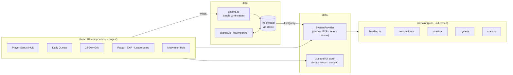

<div align="center">


# The System · RPG Habit Tracker

**Turn your daily habits into quests. Earn EXP, keep your streak, rank up from E to S.**

A Progressive Web App with free accounts and multi-device sync, inspired by the *“System”* HUD from the Solo Leveling webtoon.
I rebuilt it from my own Google Sheets habit tracker so it could do what a spreadsheet can't.


[**Set it up →**](#-put-it-online-with-accounts-free) · [Features](#-features) · [Screenshots](#-screenshots) · [Architecture](#-architecture) · [Design decisions](#-design-decisions-backed-by-research)

</div>

---

## Why I built this

I tracked 27 daily habits in a Google Sheet: a 28-day checkbox grid, weekly donut charts, and an EXP column.
It worked, but a spreadsheet **can't embed a video, play a sound, animate a level-up, or feel good to use on a phone.**
Those small rewards are what keep a habit going.

So I rebuilt it as a real app, with one rule: **checking in must take under 2 seconds, and nothing should ever make me feel bad for being human.**

## 🎨 The look: "System windows"

Every screen is a **System window**, modelled on the blue holographic HUD from the anime:
translucent deep-blue glass, a bright glowing 1px frame, a circled **"!"** glyph with a boxed title (`STATUS`, `QUEST INFO`, `NOTIFICATION`), and a light-flash *pop-in* when a window opens. Faint mana motes drift up through the background.

- **STATUS** shows a big LEVEL number, `JOB / TITLE / NAME`, EXP and QUEST bars, and a stat table (`STR · AGI · INT · VIT · SEN`).
- **QUEST INFO** opens with *[Daily Quest has arrived.]*, then a GOAL list with `[0/1]` counters, a REWARD line, and a red **WARNING** about the Emergency Quest.
- **NOTIFICATION** windows announce every cleared quest, a completed daily quest, and each *LEVEL UP!*

All artwork, text, and audio are original. The style is inspired by the anime, not copied from it.

## ✨ Features

| | |
|---|---|
| ⚔️ **Daily Quest window** | One tap per quest, grouped by category, with difficulty and attribute tags and live EXP |
| 🏅 **Hunter Rank & Levels** | Total EXP drives Level 1 → 26+ and rank E → D → C → B → A → S (S-Rank Lv 36+ unlocks *National Level*) |
| 🔥 **Forgiving streaks** | Counts days with ≥ 50% completion. Today never breaks it while it's still in progress, and **rest days** neither break nor extend it |
| 📅 **28-day habit grid** | The spreadsheet view, upgraded: sticky columns, a glowing *today* beam, per-quest totals, and a daily % row |
| 🍩 **Weekly analytics** | 4 donut rings + daily bar charts, colour-coded W1 cyan → W4 crimson |
| 🕸️ **Attribute radar** | STR · AGI · INT · VIT · SEN, built from the EXP earned in each attribute |
| 📈 **EXP history & leaderboard** | Cumulative EXP curve (30D/90D/1Y) and the top 10 most consistent quests |
| 🎬 **Motivation Hub** | Quote + embedded **YouTube / Shorts**, **Facebook Reels**, or **your own MP4/WebM** (stored offline), with theater mode |
| 🎵 **System Anthem & SFX** | Sound effects and a looping anthem, **synthesized live with the Web Audio API** (0 KB of audio files) |
| 🚨 **Emergency Quest** | After 10 PM with < 40% done, a pulsing red *Penalty Zone* alert appears (it's a warning only and never takes anything away) |
| 🆙 **Level-up / Rank-up modal** | A full-screen System notification with a particle burst |
| 🗂️ **Quest editor** | Add, edit, reorder, **schedule by weekday**, archive (keeps EXP) or delete |
| 💾 **Backups & migration** | One-click JSON export/restore, a **Google Sheets CSV importer**, and a weekly backup reminder |
| 📱 **Installable PWA** | Works offline, installs to your home screen, and has a mobile bottom navigation bar |

## 📸 Screenshots

| Today (desktop) | 28-Day Grid |
|---|---|
|  |  |
| **Stats** | **Level up** |
|  |  |

<p align="center">
  
  &nbsp;&nbsp;
  
</p>

> Screenshots are generated automatically from the production build in demo mode (`npm run screenshots`).

## 🧠 Design decisions (backed by research)

Before writing code I studied what successful habit apps do (Habitica, Streaks, Finch, and the wave of Solo-Leveling-style apps) and **why people quit them**. Five findings shaped the design:

| Finding | What I built |
|---|---|
| **Streak anxiety** is one of the most common reasons people abandon habit trackers | A forgiving streak: rest days, and *today* doesn't count against you until it's over |
| Habitica's biggest complaint is "everything is daily," which punishes habits like *training-day-only* | **Weekday schedules**. Unscheduled days don't count against your completion % |
| **Data loss** is the #1 theme in 1–3★ reviews | Cloud accounts, changes held safely on the device until the server confirms them, JSON backups, and a 7-day backup reminder |
| Too many effects make gamification tiring | Small effects (a chirp and a toast) for each check-in; fanfare only for a level-up or a 100% day |
| Friction kills habits | One-tap check-in, a phone-first layout, and a PWA that opens instantly and works offline |

Full research notes and the original build plan: [docs/PLAN.md](docs/PLAN.md).

## 🏗 Architecture



**Key principles**

- **Store facts, derive everything else.** Only quests, completions, rest days, and settings are persisted. EXP, level, rank, streak, and percentages are computed by pure functions, so they can never drift out of sync.
- **History is saved with each record.** Each completion stores the EXP it was worth at the time, so editing a quest's reward never rewrites the past.
- **An explicit timezone, never UTC.** A late-night check-in in Dhaka (UTC+6) lands on the correct day, on every device.
- **One write path** (`data/actions.ts`) queues every change for upload in the same transaction that saves it. See [docs/DATA-MODEL.md](docs/DATA-MODEL.md).

More detail: [docs/ARCHITECTURE.md](docs/ARCHITECTURE.md).

## 🧰 Tech stack

| Layer | Choice | Why |
|---|---|---|
| UI | **React 18 + TypeScript (strict)** | Component model and type safety |
| Build | **Vite 5** | Instant dev server, small production builds |
| Styling | **Tailwind CSS** | Design tokens for the neon/glass "System" look |
| Motion | **Framer Motion** | Spring animations, modal and particle effects |
| Charts | **Recharts** + hand-built SVG donuts | Radar, area, and bar charts with tooltips |
| Storage | **Dexie (IndexedDB)** + `dexie-react-hooks` | Instant local reads, and a safe queue for unsent changes |
| Accounts & sync | **Supabase** (Auth + Postgres + Row Level Security) | Free sign-in and private cloud storage |
| State | **zustand** | Tiny store for UI-only state |
| PWA | **vite-plugin-pwa (Workbox)** | Installable, offline, auto-updating |
| Audio | **Web Audio API** | Synthesized sound effects and anthem, no assets |
| Tests | **Vitest**, **PGlite** | Unit tests, plus sync and security tests on real Postgres |
| Tooling | **playwright-core** | Automated README screenshots using the local Edge browser |

## 🚀 Put it online with accounts (free)

This takes about 20 minutes. You need a GitHub account and a free Supabase account. Do the steps in order.

The steps use this project's repository, `NS-Sami/solo-leveling-habit-tracker`, so your site address will be:

```
https://ns-sami.github.io/solo-leveling-habit-tracker/
```

If you fork or rename the repository, replace that address everywhere below. Keep the `/` at the end.

### Step 1: Create the Supabase project

1. Go to <https://supabase.com> and sign up.
2. Click **New project**. Choose a name and a region near you (Singapore or Mumbai are close to Bangladesh).
3. Set a database password and store it in a password manager. **This password never goes in any project file.**
4. Wait until the project finishes setting up.

### Step 2: Create the database tables

1. In the Supabase dashboard, open **SQL Editor** and click **New query**.
2. Open [`supabase/migrations/0001_init.sql`](supabase/migrations/0001_init.sql) from this project, and copy the whole file.
3. Paste it into the editor and click **Run**. You should see a success message.
4. Open **Table Editor**. You should see `quests`, `completions`, `day_meta` and `user_settings`, and each should show that Row Level Security (RLS) is on.

The file is safe to run again, and it never deletes data.

### Step 3: Configure sign-in

Open **Authentication → URL Configuration** (Supabase sometimes moves this menu; look under **Authentication**) and set:

| Setting | Value |
|---|---|
| **Site URL** | `https://ns-sami.github.io/solo-leveling-habit-tracker/` |
| **Redirect URLs** (add both) | `https://ns-sami.github.io/solo-leveling-habit-tracker/` |
| | `http://localhost:5173/**` |

The first address is your live site. The second lets email links work while you run the app on your computer. If an email link later fails with a redirect error, this list is the first thing to check.

**Email confirmation.** When "Confirm email" is on (under **Authentication → Sign In / Providers → Email**), a new user must click a link in an email before they can sign in. This proves they own the address.

> ⚠️ **Supabase's built-in email is only for testing.** It delivers only to members of your Supabase organization, and it is limited to about 2 emails per hour for the whole project. So this works for you, but friends will not receive confirmation or password reset emails.
>
> **To invite other people, choose one:**
> - **Set up custom SMTP** (Authentication → SMTP settings) with an email provider. This is the proper fix, and password reset emails then work for everyone.
> - **Turn off "Confirm email".** Sign-up then works instantly with no email. The catch is that nobody proves they own the address, and password reset still needs working email.

### Step 4: Add your project keys

1. In Supabase, open **Project Settings**. Copy your **Project URL**, and from **API Keys** copy the **Publishable key** (it starts with `sb_publishable_`).
2. Open [`public/config.js`](public/config.js) and fill in both values:

```js
window.SYSTEM_CONFIG = {
  supabaseUrl: 'https://YOUR-PROJECT-REF.supabase.co',
  supabasePublishableKey: 'sb_publishable_YOUR-PUBLISHABLE-KEY',
};
```

**Is it safe to publish this?** Yes. The publishable key is designed to be public, and anyone can read it in their browser. Your data is protected by the Row Level Security rules from Step 2, not by hiding this key. Frontend files and environment variables can never hide a secret, because they all end up in the visitor's browser.

> 🚨 **Never** put a secret key (`sb_secret_...`), a `service_role` key or your database password in this project. They bypass all security rules. The app refuses to start with one, and the deploy workflow stops if it finds one. If one is ever committed, rotate it in Supabase immediately.

### Step 5: Bring over progress from your computer (optional)

Progress is saved per website address, so anything on `http://localhost:5173` is not visible on the live site. To keep it:

1. Run `npm install`, then `npm run dev`, and open `http://localhost:5173` in the **same browser** you used before.
2. Create your account, or sign in.
3. When the **Import Progress** window appears, check the numbers and click **Import to My Account**.

Nothing is uploaded without that click. Existing online records are kept, importing twice creates no duplicates, and the copy in your browser stays until you remove it yourself in **Settings → Account**.

### Step 6: Push to GitHub and turn on Pages

1. Send your changes to GitHub:

   ```bash
   git add .
   git commit -m "Add Supabase accounts and multi-device sync"
   git push
   ```

2. On GitHub, open your repository, then **Settings → Pages**.
3. Under **Build and deployment → Source**, choose **GitHub Actions**.

   This step is required. It is why the first deployment failed: the build passed, but Pages was not switched on.

4. Open the **Actions** tab. If the latest run failed, click it and choose **Re-run all jobs**. Wait for a green check mark.
5. Open your site address.

### Step 7: Check the live site

- [ ] The sign-in screen appears, with the correct fonts and styling.
- [ ] Create an account. The confirmation email arrives, and its link opens your site and signs you in.
- [ ] Tick a quest. The badge in the header goes from **Saving** to **Saved**.
- [ ] In Supabase **Table Editor → completions**, the row is there.
- [ ] Refresh the page. The tick is still there.
- [ ] Sign in on your phone. The same progress appears.
- [ ] Tick a quest on the phone, then refresh the laptop. It appears.
- [ ] Create a second account with another email. It shows none of the first account's progress.
- [ ] Sign out, use **Forgot password?**, and follow the email link to set a new password.
- [ ] Turn on airplane mode, tick a quest, then reconnect. It uploads and shows **Saved**.

To install it as an app on your phone, see [docs/DEPLOYMENT.md](docs/DEPLOYMENT.md).

### Free plan limits

These can change, so check <https://supabase.com/pricing> for current numbers.

| Service | Limit to know about |
|---|---|
| **Supabase pausing** | A free project **pauses after about 7 days with no activity**. Your data is kept, but the site cannot load or save online until you press **Restore** in the Supabase dashboard. Daily use keeps it awake. While paused, the app shows it cannot reach the server and keeps new changes on the device. |
| **Supabase database** | 500 MB per project. Years of habit data fit comfortably. Uploaded videos and audio are not stored online. |
| **Supabase users** | About 50,000 monthly active users, and 2 active free projects per account. |
| **Supabase email** | See the warning in Step 3. |
| **GitHub Pages** | Free for public repositories. The site is public, but each person's data stays private behind their account. |

### How saving works

- **Saving, Saved:** "Saved" appears only after the database confirms every change.
- **Offline:** you can keep using the app. Changes wait safely on the device and upload when the connection returns. Other devices see them after that. The app explains this on screen.
- **Two devices:** for a tick or rest day, the later edit wins. If the same quest or settings were changed on two devices, nothing is overwritten and the app asks which version to keep.
- **Timezone:** the day changes at midnight in your chosen timezone (default Asia/Dhaka), on every device. Change it in **Settings → System Rules**.
- **Not synced:** uploaded videos and audio, plus volume and sound on/off, stay on each device.
- **Shared computer:** when signing out, tick **This is a shared device** to remove your data from that browser.
- **Backups:** **Settings → Export JSON** downloads all your records.

## 💻 Run it on your computer

```bash
# requires Node.js 18+
npm install
npm run dev          # http://localhost:5173
```

With `public/config.js` left empty, the app runs in "This device only" mode, with no account.
Add `?demo=1` to the address to explore sample data. Demo data has its own storage and is never uploaded.

| Command | What it does |
|---|---|
| `npm test` | Unit, sync and security tests |
| `npm run build` | Production build into `dist/` |
| `npm run e2e` | Browser test of the build (run `npm run build` first; needs Node 23.6+ and Edge) |
| `npm run screenshots` | Regenerates `docs/screenshots/` |
| `python scripts/make_cover.py` | Rebuilds the README banner and LinkedIn cover |

## 🗺 Roadmap

- [ ] Push-notification reminders (morning quest / 9 PM emergency)
- [ ] Weekly "Dungeon" boss challenges and titles
- [ ] Shareable progress card (PNG) for social posts

## 📄 License & credits

MIT © Asif Hossain. *Solo Leveling* is the property of its creators. This is an independent fan-inspired project. All artwork, icons, and audio here are original (the audio is synthesized in code) and no official assets are used.
